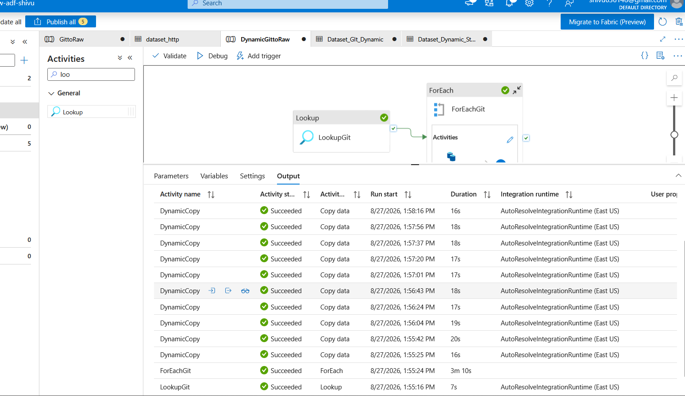
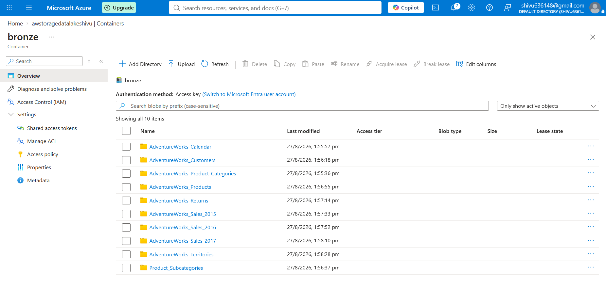
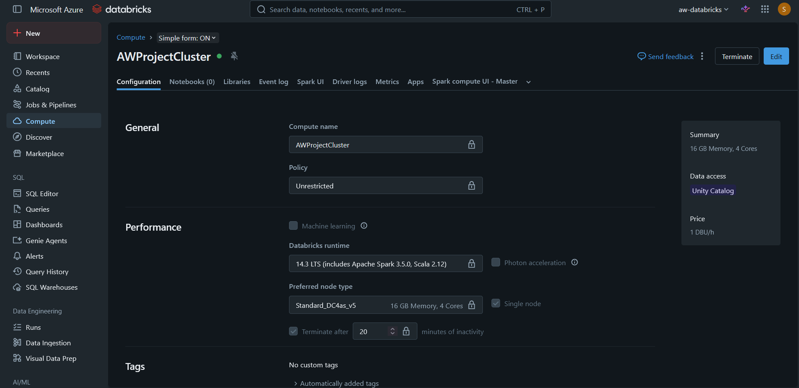
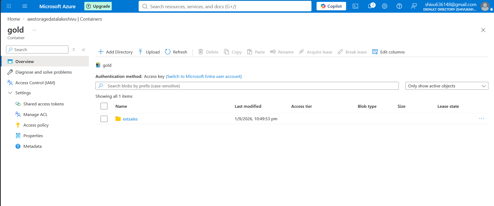
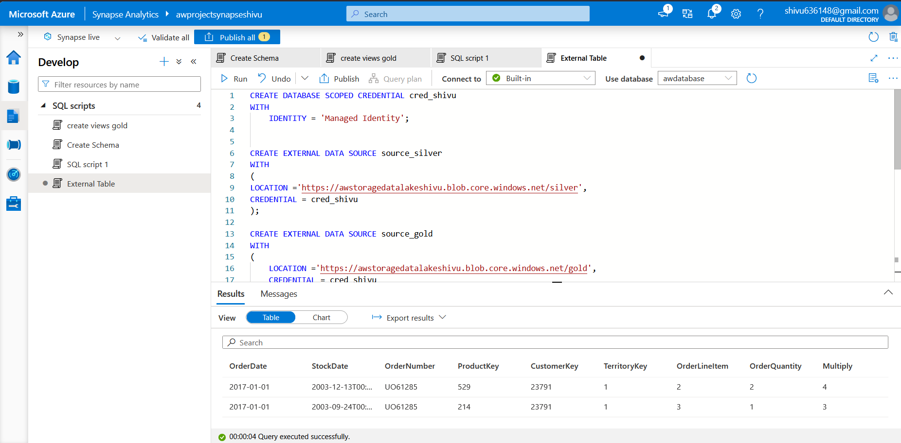
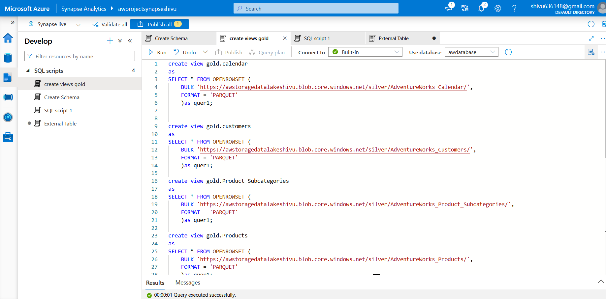
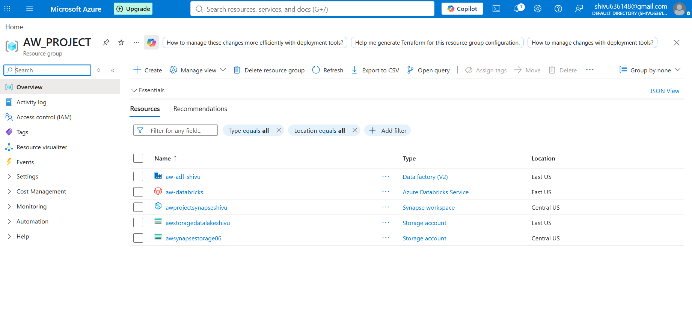

**# 🚀 End-to-End AdventureWorks Data Engineering Project on Azure**

An end-to-end data engineering solution built using **Azure Data Factory, Azure Data Lake Storage Gen2, Azure Databricks, Azure Synapse Analytics, and Power BI**.

This project demonstrates how raw AdventureWorks data can be ingested from an HTTP/GitHub source, stored in a **Bronze** layer, transformed using **PySpark in Databricks**, stored in a **Silver** layer as Parquet, and exposed through **Synapse Serverless SQL** for analytics and BI consumption.

---

**## 👨‍💻 Author**

**Shiva Kumar**

- GitHub: [Shivu-06](https://github.com/Shivu-06)

- Project Repository: [Adventure-Works-Azure-Data-Engineering-Project](https://github.com/Shivu-06/Adventure-Works-Data-Engineering-Project.git)

---

**## 📌 Project Overview**

The AdventureWorks dataset contains business data related to customers, products, sales, returns, territories, and product categories.

The objective of this project is to build a complete cloud-based data engineering pipeline that:

1. Ingests source data from an HTTP/GitHub location.

2. Stores raw data in Azure Data Lake Storage Gen2.

3. Uses a dynamic Azure Data Factory pipeline to process multiple files.

4. Transforms and cleans the data using Azure Databricks and PySpark.

5. Stores transformed data in Parquet format in the Silver layer.

6. Uses Azure Synapse Analytics Serverless SQL to query the processed data.

7. Creates SQL views for analytical consumption.

8. Provides a foundation for Power BI reporting.

---

**# 🏗️ Architecture**


**### Data Flow**

```text

                ┌─────────────────┐

                │   Data Source   │

                │   HTTP / GitHub │

                └────────┬────────┘

                         │

                         ▼

                ┌─────────────────┐

                │ Azure Data      │

                │ Factory (ADF)   │

                └────────┬────────┘

                         │

                         ▼

                ┌─────────────────┐

                │ ADLS Gen2       │

                │ Bronze Layer    │

                └────────┬────────┘

                         │

                         ▼

                ┌─────────────────┐

                │ Azure           │

                │ Databricks      │

                │ PySpark         │

                └────────┬────────┘

                         │

                         ▼

                ┌─────────────────┐

                │ ADLS Gen2       │

                │ Silver Layer    │

                │ Parquet         │

                └────────┬────────┘

                         │

                         ▼

                ┌─────────────────┐

                │ Azure Synapse   │

                │ Serverless SQL  │

                └────────┬────────┘

                         │

                         ▼

                ┌─────────────────┐

                │ Gold / SQL Views│

                │ Serving Layer   │

                └────────┬────────┘

                         │

                         ▼

                ┌─────────────────┐

                │    Power BI     │

                └─────────────────┘

```

---

**# 🛠️ Technologies Used**

\| Technology | Purpose |

\|---|---|

\| **Azure Data Factory** | Data ingestion and pipeline orchestration |

\| **Azure Data Lake Storage Gen2** | Cloud data lake and Bronze/Silver/Gold storage |

\| **Azure Databricks** | Data transformation using PySpark |

\| **Apache Spark** | Distributed data processing |

\| **Azure Synapse Analytics** | Serverless SQL querying and data serving |

\| **SQL** | External data access, views, and analytical queries |

\| **Parquet** | Optimized storage format for analytical workloads |

\| **Power BI** | Business intelligence and reporting layer |

\| **GitHub** | Source control and project documentation |

\| **Python / PySpark** | Data transformation |

---

**# ☁️ Azure Resources**

The project was implemented using the following Azure resources:

\| Resource | Name |

\|---|---|

\| Resource Group | `AW_PROJECT` |

\| Azure Data Factory | `aw-adf-shivu` |

\| Azure Databricks | `aw-databricks` |

\| Databricks Cluster | `AWProjectCluster` |

\| ADLS Gen2 Storage Account | `awstoragedatalakeshivu` |

\| Synapse Workspace | `awprojectsynapseshivu` |

\| Synapse SQL Database | `awdatabase` |

\| Additional Storage Account | `awsynapsestorage06` |

\| Primary Azure Region | East US |

\| Synapse Workspace Region | Central US |

---

**# 📥 1. Data Ingestion with Azure Data Factory**

Azure Data Factory is used as the orchestration layer.

The AdventureWorks CSV files are obtained through an HTTP/GitHub-based source and copied into the **Bronze container** in ADLS Gen2.

**## ADF Pipelines**

Two pipelines were created:

**###** `GittoRaw`

A basic ingestion pipeline containing a Copy Data activity.

**###** `DynamicGittoRaw`

A dynamic ingestion pipeline that uses:

```text

Lookup

   ↓

ForEach

   ↓

Dynamic Copy

```

The Lookup activity retrieves the list of files, the ForEach activity iterates through the returned items, and the Dynamic Copy activity copies each file into the appropriate Bronze location.

This approach avoids creating a separate Copy activity for every individual dataset.

**## ADF Overview**


**## Dynamic ADF Pipeline**


**## ForEach and Dynamic Copy**



The ADF execution screenshot also demonstrates successful execution of multiple `DynamicCopy` activities.

---

**# 🗄️ 2. Azure Data Lake Storage Gen2**

Azure Data Lake Storage Gen2 is used as the central storage layer.

The data lake follows a medallion-style structure:

```text

ADLS Gen2

│

├── bronze

│   └── Raw source data

│

├── silver

│   └── Cleaned and transformed Parquet data

│

├── gold

│   └── Curated analytical data

│

└── parameters

    └── Pipeline configuration files

```

**## Storage Containers**


---

**# 🥉 3. Bronze Layer**

The Bronze layer stores the raw data after ingestion from the source.

The data is kept close to its original form so that it can be reprocessed when required.

**### Bronze datasets**

```text

AdventureWorks_Calendar

AdventureWorks_Customers

AdventureWorks_Product_Categories

AdventureWorks_Products

AdventureWorks_Returns

AdventureWorks_Sales_2015

AdventureWorks_Sales_2016

AdventureWorks_Sales_2017

AdventureWorks_Territories

Product_Subcategories

```



---

**# ⚙️ 4. Data Transformation with Azure Databricks**

Azure Databricks is used to process the Bronze data using **Python and PySpark**.

A Databricks cluster named:

```text

AWProjectCluster

```

was created for the transformation workload.

**## Cluster Configuration**

- Runtime: **Databricks 14.3 LTS**

- Apache Spark: **3.5.0**

- Scala: **2.12**

- Node Type: **Standard_DC4as_v5**

- Memory: **16 GB**

- Cores: **4**

- Configuration: **Single Node**

- Auto termination: **20 minutes**



---

**# 🔄 5. PySpark Transformations**

The Databricks notebook:

```text

Data Transformations(Bronze_to_Silver)

```

contains the Bronze-to-Silver transformation logic.

Examples of transformations include:

- Selecting and transforming columns

- Splitting string values

- Extracting portions of product values

- Creating derived columns

- Concatenating customer name fields

- Cleaning and standardizing data

- Preparing datasets for analytical querying

- Writing transformed datasets in Parquet format

**### Example transformation**

Customer information can be combined to create a full name from individual fields:

```text

Prefix + FirstName + LastName

             ↓

          FullName

```

Product fields are also processed using PySpark string operations such as `split()`.

Example:

```python

df_pro = df_pro.withColumn(

    "ProductSKU",

    split(col("ProductSKU"), "-")[0]

).withColumn(

    "ProductName",

    split(col("ProductName"), ",")[0]

)

```


---

**# 🥈 6. Silver Layer**

After transformation, the cleaned datasets are stored in the Silver container in **Parquet format**.

The Silver layer contains:

```text

AdventureWorks_Calendar

AdventureWorks_Customers

AdventureWorks_Product_Subcategories

AdventureWorks_Products

AdventureWorks_Returns

AdventureWorks_Sales

AdventureWorks_Territories

```


**### Why Parquet?**

Parquet is a columnar storage format well suited for analytical workloads because it supports:

- Efficient column-level reads

- Compression

- Reduced storage requirements

- Better analytical query performance

- Compatibility with Spark and Synapse

---

**# 🥇 7. Gold Layer**

The Gold layer contains curated data prepared for downstream analytical consumption.

In this project, the Gold container contains:

```text

extsales

```



The Gold/serving layer is intended to provide business-ready data for reporting and analytical workloads.

---

**# 📊 8. Azure Synapse Analytics**

Azure Synapse Analytics is used as the serving and SQL query layer.

The Synapse workspace used in this project is:

```text

awprojectsynapseshivu

```

with the SQL database:

```text

awdatabase

```

**## Synapse Configuration**

The Synapse workspace uses its managed identity to access Azure Data Lake Storage.

The required storage permissions were configured through Azure IAM/RBAC.





---

**# 🔐 9. Managed Identity and Security**

The project uses Azure Managed Identity for Synapse-to-Storage authentication rather than storing storage credentials directly in SQL scripts.

General flow:

```text

Synapse Serverless SQL

        │

        │ Managed Identity

        ▼

Azure Data Lake Storage Gen2

```

Example database-scoped credential:

```sql

CREATE DATABASE SCOPED CREDENTIAL cred_shivu

WITH

(

    IDENTITY = 'Managed Identity'

);

```

External data sources can then reference this credential.

\> **Security note:** Never commit real passwords, access keys, SAS tokens, connection strings, or other secrets to GitHub. Use placeholders or Azure-managed authentication.

---

**# 🧱 10. External Data Sources**

The Synapse SQL layer defines external data sources for the Silver and Gold containers.

Example:

```sql

CREATE EXTERNAL DATA SOURCE source_silver

WITH

(

    LOCATION = 'https://\<storage-account>.dfs.core.windows.net/silver',

    CREDENTIAL = cred_shivu

);

```

and:

```sql

CREATE EXTERNAL DATA SOURCE source_gold

WITH

(

    LOCATION = 'https://\<storage-account>.dfs.core.windows.net/gold',

    CREDENTIAL = cred_shivu

);

```

An external Parquet file format is also configured:

```sql

CREATE EXTERNAL FILE FORMAT format_parquet

WITH

(

    FORMAT_TYPE = PARQUET,

    DATA_COMPRESSION = 'org.apache.hadoop.io.compress.SnappyCodec'

);

```

---

**# 🔎 11. Querying Silver Data with OPENROWSET**

Synapse Serverless SQL can directly query the Parquet data stored in ADLS Gen2.

Example:

```sql

SELECT \*

FROM OPENROWSET

(

    BULK 'https://\<storage-account>.blob.core.windows.net/silver/AdventureWorks_Calendar/',

    FORMAT = 'PARQUET'

) AS query1;

```

This allows analytical queries without first loading the Parquet data into a traditional dedicated warehouse.


---

**# 👁️ 12. SQL Views**

SQL views are created in the `gold` schema to provide a simplified serving layer.

Examples include:

```text

gold.calendar

gold.customers

gold.Product_Subcategories

gold.Products

```

The views read the transformed Parquet datasets from the Silver layer using `OPENROWSET`.

Example:

```sql

CREATE VIEW gold.calendar

AS

SELECT \*

FROM OPENROWSET

(

    BULK 'https://\<storage-account>.blob.core.windows.net/silver/AdventureWorks_Calendar/',

    FORMAT = 'PARQUET'

) AS query1;

```

The same pattern can be applied to the other Silver datasets.

---

**# 📈 13. Business Intelligence / Power BI**

The final serving layer is designed for BI consumption.

```text

ADLS Silver

     ↓

Synapse Serverless SQL

     ↓

Gold Views

     ↓

Power BI

```

Power BI can connect to the Synapse serving layer and use the curated SQL views to create business reports and dashboards.

Typical analytical areas include:

- Sales performance

- Customer analysis

- Product analysis

- Territory performance

- Returns analysis

- Year-over-year sales trends

- Product category performance

---

**# 📈 14. Power BI – Business Intelligence Layer

Power BI is the final **business intelligence and visualization layer** of the project.

The curated data exposed through **Azure Synapse Serverless SQL and Gold SQL views** is used as the reporting source for Power BI.

### Power BI Data Flow

```text
ADLS Gen2 – Silver
        ↓
Azure Synapse Serverless SQL
        ↓
Gold SQL Views
        ↓
Power BI
        ↓
Interactive Dashboard
```

### Power BI Project File

The Power BI report is included in the repository:

```text
Power BI/
└── AdventureWorks.pbix
```

The report can be opened in **Power BI Desktop** to inspect the data model, relationships, measures, and report pages.

### Dashboard Analysis

The Power BI dashboard is designed around the AdventureWorks business data and can be used to analyze:

- Sales performance
- Customer analysis
- Product performance
- Product category performance
- Territory/region performance
- Returns analysis
- Year-over-year sales trends

### Power BI Dashboard Screenshot


### Power BI in the End-to-End Architecture

Power BI completes the pipeline by turning the curated analytical data into business-facing reports:

```text
GitHub / HTTP Source
        ↓
Azure Data Factory
        ↓
ADLS Gen2 – Bronze
        ↓
Azure Databricks + PySpark
        ↓
ADLS Gen2 – Silver / Parquet
        ↓
Azure Synapse Serverless SQL
        ↓
Gold SQL Views
        ↓
Power BI Dashboard
```

# 📂 14. Project Structure**

```text

Adventure-Works-Azure-Data-Engineering-Project/

│

├── ADF-Script/

│   └── git.json

│

├── Dataset/

│   ├── AdventureWorks_Calendar.csv

│   ├── AdventureWorks_Customers.csv

│   ├── AdventureWorks_Product_Categories.csv

│   ├── AdventureWorks_Product_Subcategories.csv

│   ├── AdventureWorks_Products.csv

│   ├── AdventureWorks_Returns.csv

│   ├── AdventureWorks_Sales_2015.csv

│   ├── AdventureWorks_Sales_2016.csv

│   ├── AdventureWorks_Sales_2017.csv

│   └── AdventureWorks_Territories.csv

│

├── Databricks/

│   └── Data Transformations(Bronze_to_Silver).ipynb

│

├── Screenshots/

│   ├── 0_Architecture-aw-project.jpg

│   ├── 01_Resource_Group.png

│   ├── 02_ADF_Overview.png

│   ├── 03_ADF_Dynamic_Pipeline.png

│   ├── 04_ADF_ForEach.png

│   ├── 05_ADLS_Containers.png

│   ├── 06_ADLS_Bronze.png

│   ├── 07_ADLS_Silver.png

│   ├── 08_ADLS_Gold.png

│   ├── 09_Databricks_Cluster.png

│   ├── 10_Silver_Notebook.png

│   ├── 11_Synapse_Managed_Identity.png

│   ├── 12_Synapse_Workspace.png

│   └── 13_Synapse_Query.png

│

├── Synapse SQL Scripts/

│   ├── External Table.sql

│   └── create views gold.sql

│

├── README.md

└── .gitignore

```

---

**# 📸 15. Implementation Screenshots**

**## Azure Resource Group**



**## Azure Data Factory**


**## Dynamic ADF Pipeline**


**## ADF ForEach**


**## ADLS Containers**


**## Bronze Layer**


**## Silver Layer**


**## Gold Layer**


**## Databricks Cluster**


**## Databricks Silver Transformation**


**## Synapse Managed Identity**


**## Synapse Workspace**


**## Synapse SQL Query**


---

**## Power BI Dashboard


# 🔁 16. End-to-End Pipeline**

The complete data flow can be summarized as:

```text

AdventureWorks CSV Files

          │

          ▼

   HTTP / GitHub Source

          │

          ▼

   Azure Data Factory

          │

          │ Dynamic Copy

          ▼

     ADLS Gen2

    Bronze Layer

          │

          │ Read Raw Data

          ▼

    Azure Databricks

       PySpark

          │

          │ Transform / Clean

          ▼

     ADLS Gen2

    Silver Layer

      Parquet

          │

          ▼

 Azure Synapse Analytics

   Serverless SQL

          │

          ▼

      Gold Views

          │

          ▼

       Power BI

```

---

**# 🎯 17. Key Features**

**### Dynamic Data Ingestion**

Instead of manually creating individual copy activities, the ADF pipeline uses Lookup + ForEach + Dynamic Copy to process multiple datasets.

**### Medallion Architecture**

The project separates data into:

```text

Bronze → Silver → Gold

```

which provides a structured approach to data processing.

**### Distributed Data Processing**

Azure Databricks and PySpark are used to transform the raw datasets.

**### Columnar Storage**

The Silver layer uses Parquet for efficient analytical processing.

**### Serverless SQL**

Synapse Serverless SQL can query files directly from ADLS without requiring a dedicated SQL warehouse.

**### Managed Identity**

Azure Managed Identity is used for secure access between Synapse and Azure Storage.

**### BI Ready**

The Gold/serving layer is designed to be consumed by Power BI.

---

**# 🧪 18. Validation Performed**

**### ADF**

- Pipeline validation

- Lookup execution

- ForEach execution

- Dynamic Copy execution

- Successful ingestion into Bronze

**### ADLS**

- Bronze folders verified

- Silver folders verified

- Gold output verified

**### Databricks**

- Cluster successfully configured

- PySpark transformations executed

- Transformed DataFrames inspected

- Silver data generated

**### Synapse**

- Managed Identity configured

- External access configured

- Serverless SQL query executed successfully

- SQL views queried successfully

---

**# 🔒 19. Security Considerations**

This repository is intended for portfolio and learning purposes.

Do **not** commit:

```text

❌ Azure passwords

❌ Storage account access keys

❌ SAS tokens

❌ GitHub Personal Access Tokens

❌ Client secrets

❌ Connection strings containing credentials

❌ Database passwords

```

Use:

```text

✔ Managed Identity

✔ Azure Key Vault

✔ Environment variables

✔ GitHub Secrets

✔ Secure placeholders

```

Any password visible during local development should be removed from the repository before pushing to GitHub.

---

**# 🚀 20. How to Run / Reproduce the Project**

**## Step 1 — Create Azure Resources**

Create:

- Resource Group

- Azure Data Factory

- ADLS Gen2 Storage Account

- Azure Databricks

- Azure Synapse Analytics

**## Step 2 — Create ADLS Containers**

Create:

```text

bronze

silver

gold

parameters

```

**## Step 3 — Configure ADF**

Configure the HTTP/GitHub source and ADLS destination.

Create:

```text

GittoRaw

DynamicGittoRaw

```

For the dynamic pipeline:

```text

Lookup → ForEach → Dynamic Copy

```

**## Step 4 — Run Ingestion**

Run the ADF pipeline and verify that the CSV files arrive in the Bronze layer.

**## Step 5 — Configure Databricks**

Create a cluster and run the Bronze-to-Silver notebook.

**## Step 6 — Write Silver Data**

Transform the Bronze datasets and save them as Parquet files in:

```text

silver/

```

**## Step 7 — Configure Synapse**

Create:

- Database

- Schema

- Database scoped credential

- External data sources

- External file format

- SQL views

**## Step 8 — Query the Data**

Use Synapse Serverless SQL and `OPENROWSET` to query the Parquet data.

**## Step 9 — Connect BI**

Use the Gold SQL views as the serving layer for Power BI reporting.

---

**# 📚 21. Learning Outcomes**

Through this project, the following data engineering concepts were implemented:

- Azure cloud resource management

- Data ingestion

- ETL/ELT concepts

- Azure Data Factory pipelines

- Dynamic pipelines

- Lookup activity

- ForEach activity

- Parameterization

- Azure Data Lake Storage Gen2

- Medallion architecture

- Bronze/Silver/Gold layers

- Apache Spark

- PySpark

- Data transformation

- Parquet

- Azure Databricks

- Synapse Serverless SQL

- `OPENROWSET`

- External data sources

- SQL views

- Managed Identity

- IAM / RBAC

- BI data serving

- GitHub version control

---

**# 🙏 Acknowledgment**

This project was built as a hands-on learning implementation inspired by publicly available AdventureWorks Azure data engineering tutorials and repositories.

Special thanks to **Ansh Lamba** for the educational material and project guidance that helped demonstrate the end-to-end Azure data engineering workflow.

The implementation, Azure resources, screenshots, configuration, and repository organization shown here are based on my own hands-on setup.

---

**# ⭐ Conclusion**

This project demonstrates a complete modern data engineering workflow using Microsoft Azure.

The pipeline follows:

```text

SOURCE

  ↓

INGESTION

  ↓

BRONZE

  ↓

TRANSFORMATION

  ↓

SILVER

  ↓

SYNAPSE

  ↓

GOLD / SERVING

  ↓

POWER BI

```

It combines orchestration, cloud storage, distributed processing, SQL analytics, security, and Power BI business intelligence into a single end-to-end data engineering solution.

---

**## 👨‍💻 Connect With Me**

**GitHub:** [Shivu-06](https://github.com/Shivu-06)

**Project:** [Adventure-Works-Azure-Data-Engineering-Project](https://github.com/Shivu-06/Adventure-Works-Data-Engineering-Project)

If you find this project useful, feel free to ⭐ the repository.