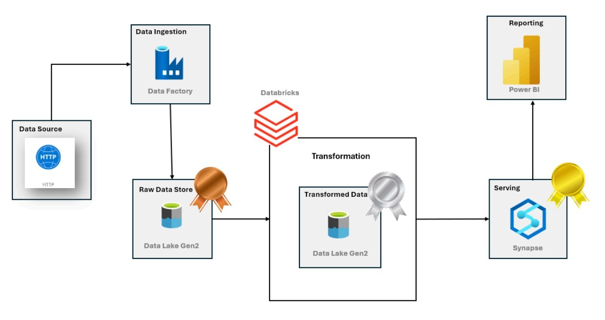
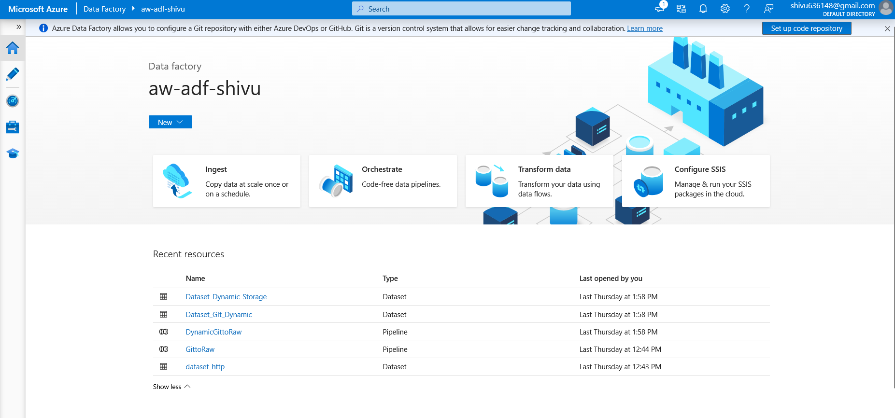
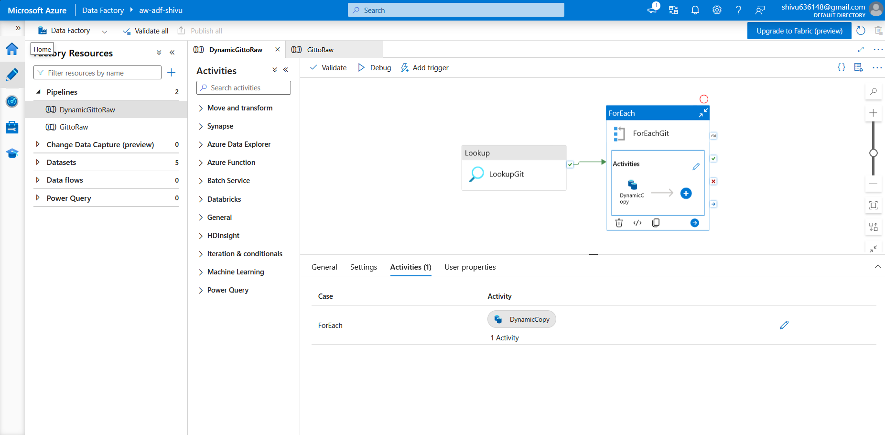
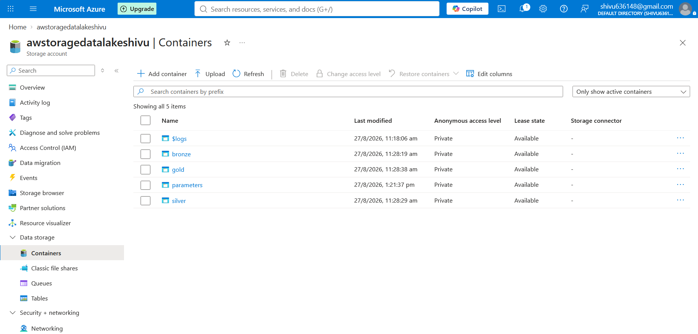
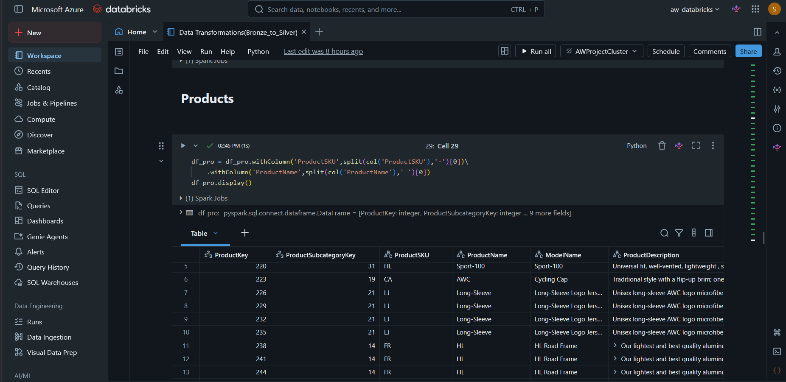
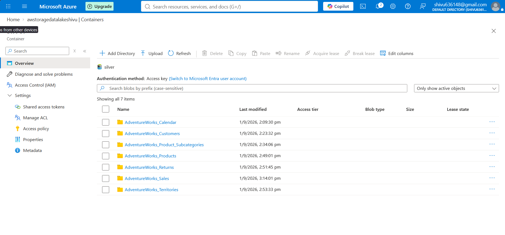
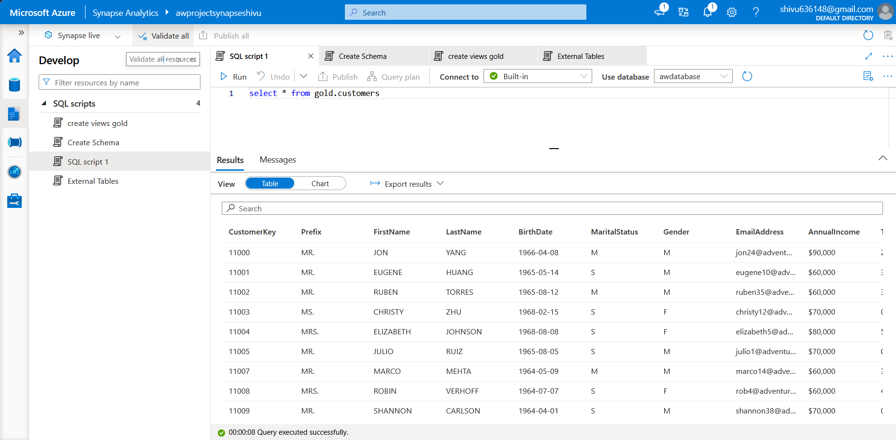
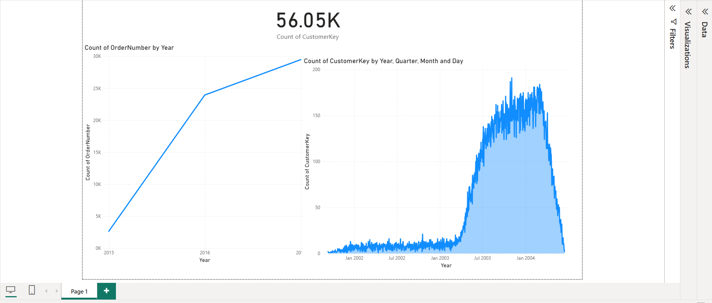

# AdventureWorks End-to-End Data Engineering Project on Azure

An end-to-end Azure Data Engineering project that ingests AdventureWorks datasets, transforms raw data using PySpark, stores processed data in Azure Data Lake Storage Gen2, and enables analytics through Azure Synapse Serverless SQL and Power BI.

## Project Overview

This project implements a cloud-based data pipeline using Azure services and a Bronze–Silver–Gold data architecture.

The pipeline demonstrates dynamic data ingestion, distributed data processing, columnar storage, SQL-based data access, and business intelligence integration.

### Key Features

* Dynamic ingestion of multiple CSV files using Azure Data Factory.
* Bronze, Silver, and Gold data lake organization.
* Data cleaning and transformation using PySpark.
* Parquet storage for transformed datasets.
* Serverless SQL queries against data stored in ADLS Gen2.
* SQL views for analytical consumption.
* Power BI dashboard integration.
* Managed Identity authentication for Synapse-to-Storage access.

## Architecture



### Data Flow

```text
HTTP / GitHub Source
        |
        v
Azure Data Factory
        |
        v
ADLS Gen2 - Bronze
        |
        v
Azure Databricks + PySpark
        |
        v
ADLS Gen2 - Silver (Parquet)
        |
        v
Azure Synapse Serverless SQL
        |
        v
Gold / SQL Views
        |
        v
Power BI Dashboard
```

## Technology Stack

| Technology                   | Purpose                                   |
| ---------------------------- | ----------------------------------------- |
| Azure Data Factory           | Data ingestion and pipeline orchestration |
| Azure Data Lake Storage Gen2 | Cloud storage and data lake layers        |
| Azure Databricks             | Distributed data processing               |
| Python and PySpark           | Data cleaning and transformation          |
| Apache Spark                 | Distributed processing engine             |
| Parquet                      | Columnar storage format                   |
| Azure Synapse Analytics      | Serverless SQL querying                   |
| SQL                          | External data access and analytical views |
| Power BI                     | Business intelligence and visualization   |
| Git and GitHub               | Version control and documentation         |

## Project Implementation

### 1. Data Ingestion with Azure Data Factory

AdventureWorks CSV datasets are ingested from an HTTP/GitHub source into Azure Data Lake Storage Gen2.

Two pipelines are documented in the project:

* `GittoRaw`: Basic ingestion using a Copy Data activity.
* `DynamicGittoRaw`: Dynamic ingestion using Lookup, ForEach, and Dynamic Copy activities.

The dynamic pipeline processes multiple files without requiring a separate Copy activity for every dataset.





### 2. Data Lake and Medallion Architecture

The storage layer is organized into the following containers:

| Layer      | Purpose                                                   |
| ---------- | --------------------------------------------------------- |
| Bronze     | Stores ingested raw datasets                              |
| Silver     | Stores cleaned and transformed datasets in Parquet format |
| Gold       | Provides a location for curated analytical outputs        |
| Parameters | Stores pipeline configuration files                       |



### 3. Data Transformation with Azure Databricks

Azure Databricks processes the Bronze datasets using Python and PySpark.

The transformation notebook is located at:

`Databricks/Data Transformations(Bronze_to_Silver).ipynb`

The documented transformations include:

* Selecting and transforming columns.
* Cleaning and standardizing values.
* Combining customer name fields.
* Extracting product information using string operations.
* Creating derived columns.
* Preparing datasets for analytical queries.
* Writing transformed data in Parquet format.

Example PySpark transformation:

```python
df_pro = df_pro.withColumn(
    "ProductSKU",
    split(col("ProductSKU"), "-")[0]
).withColumn(
    "ProductName",
    split(col("ProductName"), ",")[0]
)
```

This transformation extracts the first portion of the product SKU and product name using string splitting.



### 4. Silver Layer and Parquet Storage

After transformation, the processed datasets are stored in the Silver layer in Parquet format.

The documented Silver datasets include:

* AdventureWorks_Calendar
* AdventureWorks_Customers
* AdventureWorks_Product_Subcategories
* AdventureWorks_Products
* AdventureWorks_Returns
* AdventureWorks_Sales
* AdventureWorks_Territories

Parquet is a columnar storage format suitable for analytical workloads because it supports compression and efficient column-oriented reads.



### 5. Azure Synapse Serverless SQL

Azure Synapse Analytics provides SQL access to data stored in ADLS Gen2.

The project documentation describes the configuration of:

* Database-scoped credentials using Managed Identity.
* External data sources.
* An external Parquet file format.
* Serverless SQL queries using `OPENROWSET`.
* SQL views in the `gold` schema.

Example query pattern:

```sql
SELECT *
FROM OPENROWSET
(
    BULK 'https://<storage-account>.dfs.core.windows.net/silver/AdventureWorks_Calendar/',
    FORMAT = 'PARQUET'
) AS query1;
```

Replace `<storage-account>` with your actual storage account name when configuring the query.

This approach allows Synapse Serverless SQL to query supported files in the data lake without first loading them into a dedicated SQL warehouse.



### 6. Power BI Integration

The project includes a Power BI report at:

`Power BI/AdventureWorks.pbix`

The report is intended to use the curated analytical data exposed through Synapse SQL views.

Potential business analysis areas include:

* Sales performance.
* Customer analysis.
* Product and category performance.
* Territory analysis.
* Returns analysis.
* Year-over-year sales trends.



## Repository Structure

```text
Adventure-Works-Azure-Data-Engineering-Project/
|
|-- ADF-Script/
|   `-- git.json
|
|-- Dataset/
|   |-- AdventureWorks_Calendar.csv
|   |-- AdventureWorks_Customers.csv
|   |-- AdventureWorks_Products.csv
|   |-- AdventureWorks_Returns.csv
|   |-- AdventureWorks_Sales_2015.csv
|   |-- AdventureWorks_Sales_2016.csv
|   |-- AdventureWorks_Sales_2017.csv
|   `-- Other AdventureWorks CSV files
|
|-- Databricks/
|   `-- Data Transformations(Bronze_to_Silver).ipynb
|
|-- Synapse SQL Scripts/
|   |-- External Table.sql
|   `-- create views gold.sql
|
|-- Screenshots/
|   `-- Architecture and implementation screenshots
|
|-- Power BI/
|   `-- AdventureWorks.pbix
|
`-- README.md
```

## Validation and Testing

The existing project documentation records the following validation activities:

* Azure Data Factory pipeline validation and execution.
* Lookup and ForEach activity execution.
* Dynamic Copy activity execution.
* Verification of ingested Bronze datasets.
* Execution of PySpark transformations.
* Verification of generated Silver datasets.
* Synapse Serverless SQL query execution.
* SQL view creation and querying.

## Security Considerations

This project uses Managed Identity for the documented Synapse-to-Storage authentication flow.

For secure development:

* Never commit passwords, access keys, SAS tokens, or personal access tokens.
* Avoid exposing credentials in SQL scripts or notebooks.
* Use Azure role-based access control and appropriate storage permissions.
* Use secure configuration methods for any required secrets.

Before publishing, verify that the repository contains no real credentials or sensitive configuration.

## How to Reproduce the Project

1. Create the required Azure resources: Resource Group, Data Factory, ADLS Gen2, Databricks, and Synapse Analytics.
2. Create the required data lake containers.
3. Configure the HTTP/GitHub source and ADLS destination in Azure Data Factory.
4. Configure and execute the ingestion pipelines.
5. Verify that the raw datasets arrive in the Bronze layer.
6. Configure Databricks and run the Bronze-to-Silver transformation notebook.
7. Verify the transformed Parquet datasets in the Silver layer.
8. Configure Synapse credentials, external data sources, and SQL views.
9. Query the processed data using Synapse Serverless SQL.
10. Open the Power BI report and configure its data connection if required.

Azure resource names, permissions, storage paths, and authentication settings must be configured for your own environment.

## Key Learning Outcomes

Through this project, I worked with:

* Azure cloud resource configuration.
* Azure Data Factory orchestration.
* Dynamic ingestion using Lookup and ForEach.
* Azure Data Lake Storage Gen2.
* Bronze, Silver, and Gold data organization.
* PySpark transformations in Azure Databricks.
* Parquet storage.
* Synapse Serverless SQL and `OPENROWSET`.
* SQL views and analytical data access.
* Managed Identity and Azure permissions.
* Power BI integration.
* GitHub-based project documentation.

## Acknowledgment

This project was inspired by publicly available AdventureWorks Azure Data Engineering learning material. Special thanks to Ansh Lamba for the educational resources and project guidance.

The implementation details, Azure configuration, screenshots, and repository structure reflect my documented hands-on project work.

## Connect

* GitHub: [Shivu-06](https://github.com/Shivu-06)
* Project Repository: [AdventureWorks Azure Data Engineering Project](https://github.com/Shivu-06/Adventure-Works-Data-Engineering-Project)

If you find this project useful, feel free to star the repository.
